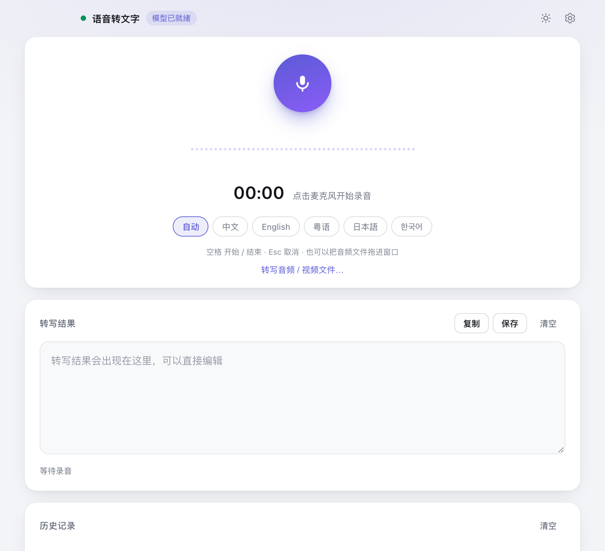
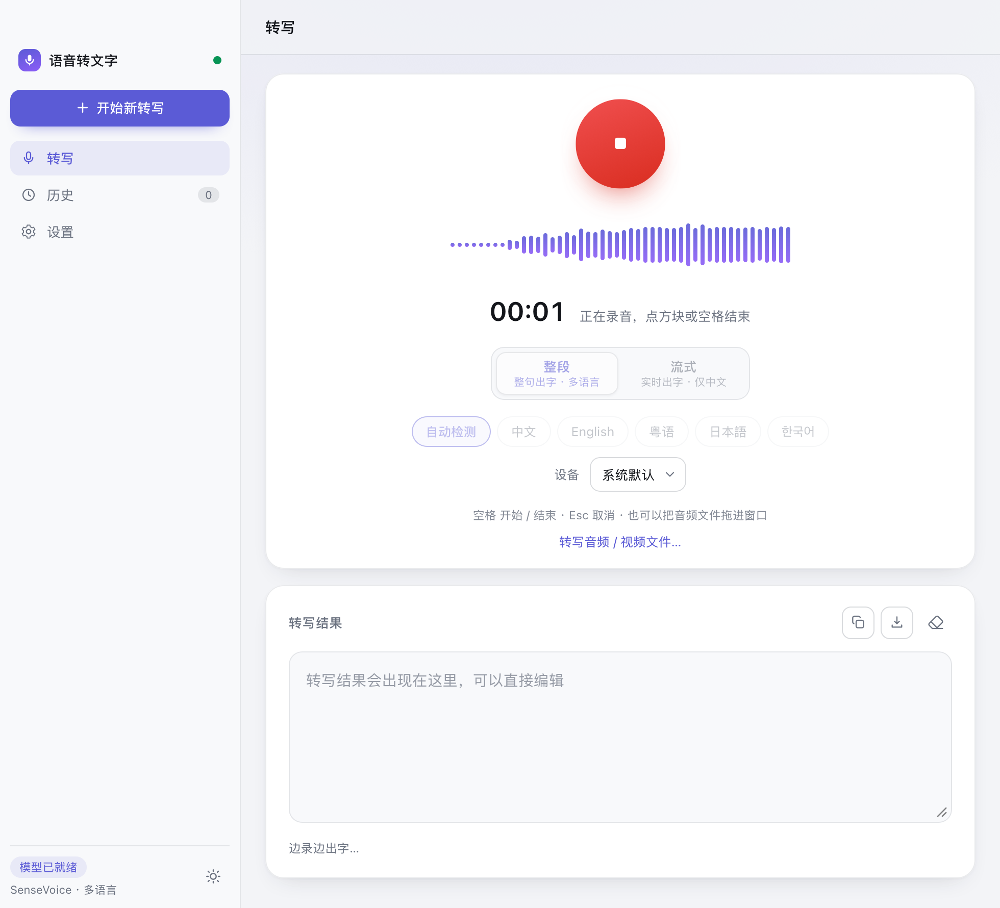
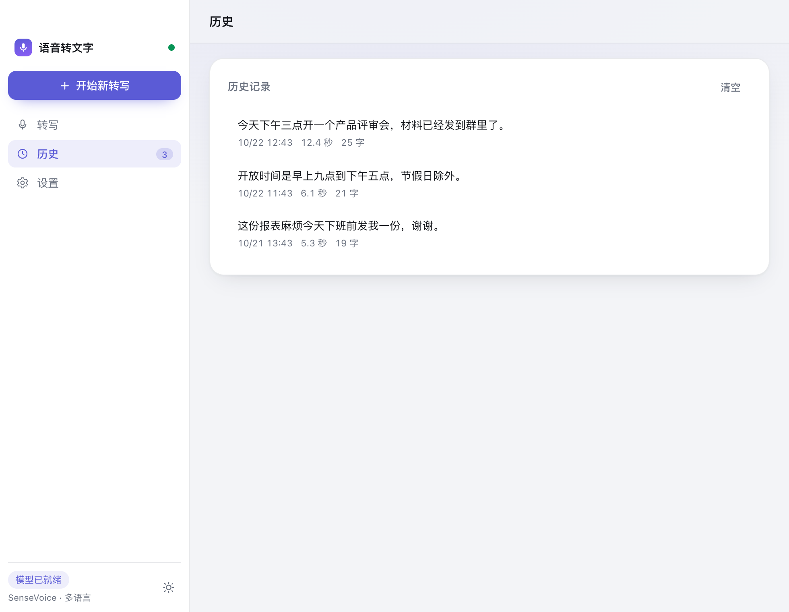
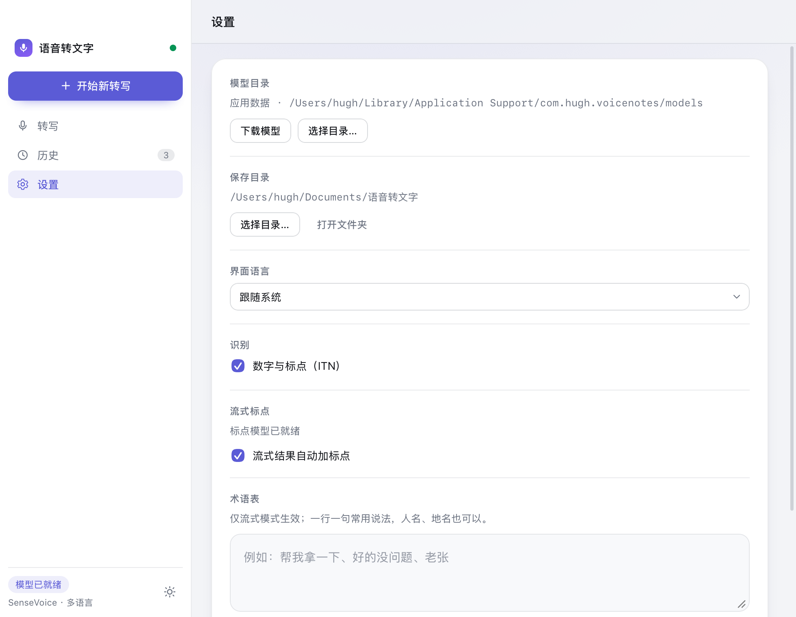
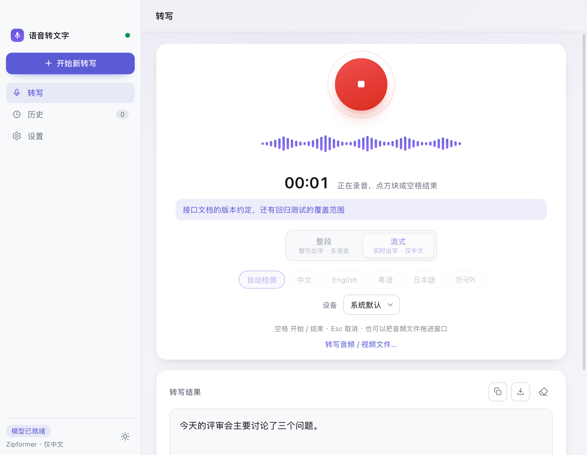
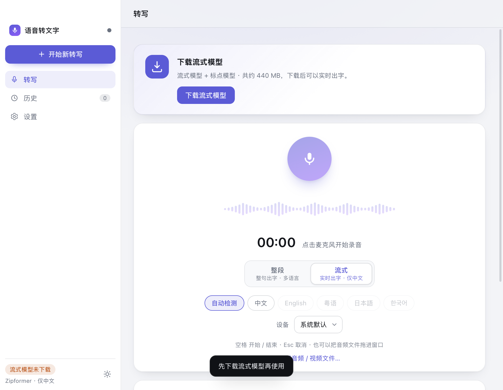
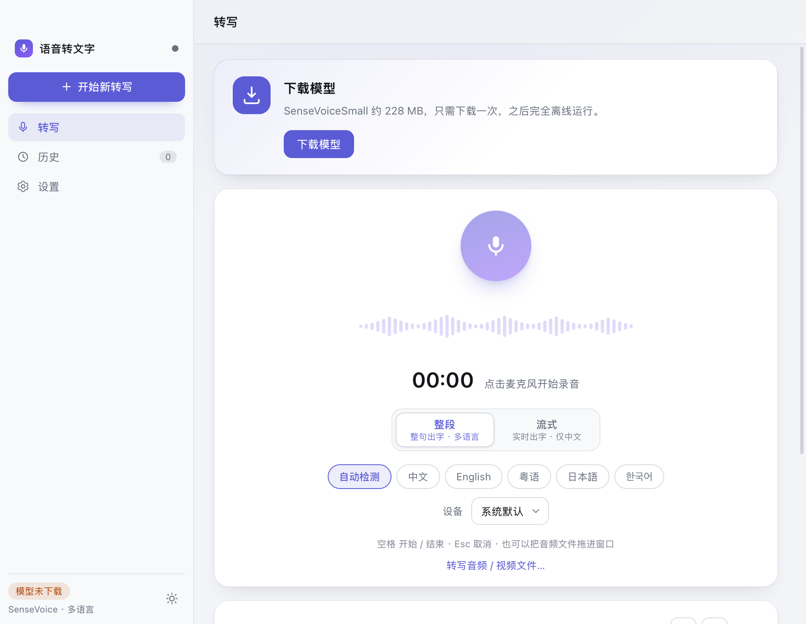
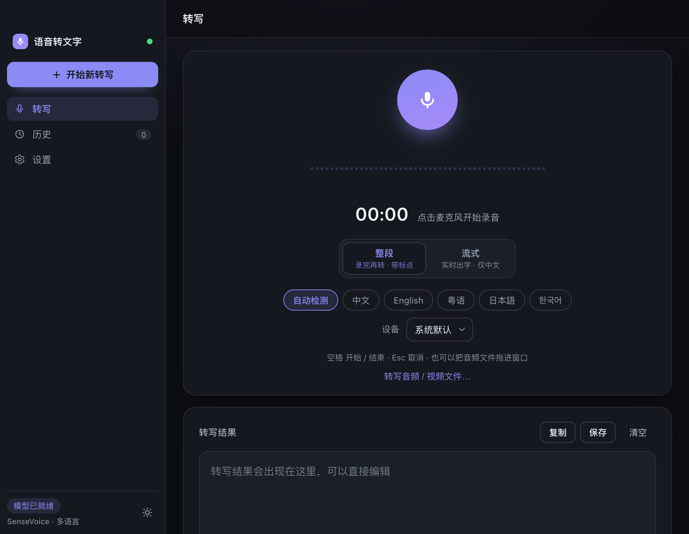
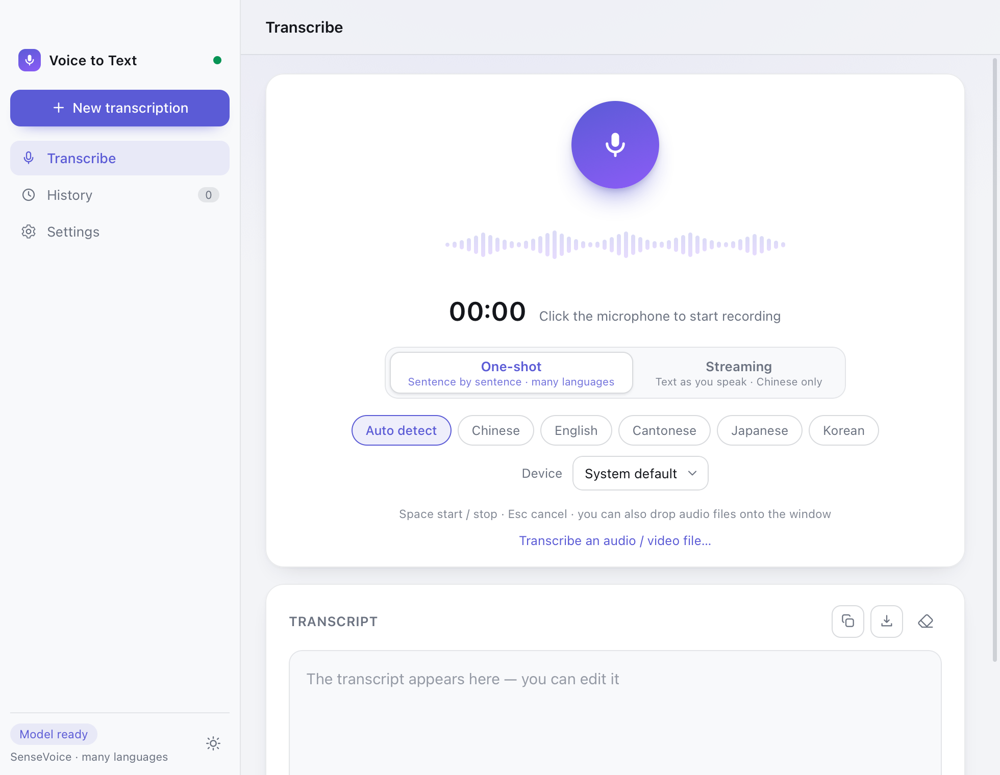

# VoiceNotes · 本地语音转文字

在 Mac / Windows 上把语音转成文字，**音频不出本机**。默认用 **SenseVoiceSmall INT8**（约 228 MB）离线识别，另有**流式模式**（Zipformer，边说边出字）。

Tauri 2 桌面应用，CPU 本地推理，不需要独立显卡；除了下载模型那一次，全程不联网。



| 录音中 | 历史记录 | 设置 |
| --- | --- | --- |
|  |  |  |

流式模式与模型下载提示：

| 流式 | 流式模型未下载 | 模型未下载 |
| --- | --- | --- |
|  |  |  |

深色主题与英文界面：

| 深色 | English |
| --- | --- |
|  |  |

## 功能

- **点麦克风开始、再点一次结束**；空格键快捷开关，Esc 取消；录音时有实时电平波形和计时。
- **两种识别方式，都是边录边出字**：
  - **整段**：SenseVoiceSmall，支持中 / 英 / 粤 / 日 / 韩 / 自动检测；按 VAD 切句后逐句识别。
  - **流式**：Zipformer transducer，仅中文；实时出字，中间结果单独一行。
- **流式术语表（热词）**：一行一句填常用说法、人名、地名（最多 100 条），解码时按热词加权，专有名词不容易再听错。
- **标点可选**：流式结果按句自动补标点（CT-Transformer，随流式模型一起下载）。
- **录音时长不限**：采集缓冲是消费式的，识别完就释放，录 1 小时和录 1 分钟占的内存一样。
- **可选输入设备**：多麦、外接声卡、回环设备都能选。
- **文件转写**：把音频 / 视频拖进窗口，或按 `⌘O` / `Ctrl+O` 选文件；后端解码（symphonia，纯 Rust，不需要 ffmpeg），支持 mp3 / wav / flac / ogg / m4a / mp4 / mov（视频轨忽略），长文件边解边转。
- **界面语言**：中文 / English，设置里可切。
- **历史记录**：只存本地（最多 100 条），一键复制、保存。
- **保存目录可指定**，默认 `文档/语音转文字/`，文件是 UTF-8 的 `.txt`。

## 安装

### macOS

CI 产物（tag `v0.3.0` 对应的 Actions Artifacts）里是 `dmg`，装完把应用拖进「应用程序」即可。

包是 **ad-hoc 签名、未公证**：首次打开会提示「无法验证开发者」，选「仍要打开」或右键 → 打开，或者：

```bash
sudo xattr -dr com.apple.quarantine /Applications/VoiceNotes.app
```

自己构建的 `dist/VoiceNotes.app` 同理。

### Windows

CI 产物是 `msi` 和 `exe`（NSIS），安装时按提示装 WebView2。模型落在 `%APPDATA%\com.hugh.voicenotes\models`。

Tauri 不能在 macOS 上交叉打 Windows 包，要自己出包得在 Windows 机器上装 Rust、Node 18+ 和 Visual Studio Build Tools（C++ 工作负载），然后 `npm run build`；也可以推 tag 让 CI 出。

### Linux

Tauri 本身支持，但 CI 不出 Linux 包，需要自己构建（依赖 `libasound2-dev`、`libwebkit2gtk-4.1-dev` 等，`cpal` 走 ALSA）。

## 首次运行：下载模型

模型不打进安装包，第一次运行要下载：

| 模型 | 大小 | 什么时候需要 |
| --- | --- | --- |
| SenseVoiceSmall INT8 | 约 228 MB | 必装，整段模式用 |
| Silero VAD | 约 2.3 MB | 随上面一起 |
| Zipformer 流式模型 | 约 161 MB | 想用流式模式时 |
| CT-Transformer 标点模型 | 约 281 MB | 随流式模型一起下载 |

1. 启动后顶部出现「下载模型」卡片（模型缺失时都会出现，不只是首次）。
2. 点「下载模型」：**优先走 `hf-mirror.com` 镜像**（国内直连 Hugging Face 经常连不上），镜像失败自动回退官方源；支持断点续传（`.part`），下完做 SHA-256 校验。
3. 想用流式：点模式切换里的「流式」，按提示下载流式 + 标点模型（共约 440 MB）。流式只覆盖中文，选粤语 / 日语 / 韩语会自动切回整段。
4. 已经有本地模型：**设置 → 模型目录 → 选择目录…**，指向一个包含下面文件的目录（随时点「使用应用内模型」切回来）：

```
model.int8.onnx   # 或 model.onnx
tokens.txt
silero_vad.onnx   # 必需：没有 VAD 就无法分句，这个目录会被判为「未就绪」
```

5. 术语表在 **设置 → 术语表** 里填（一行一句），只对流式模式生效。

模型版本是固定的（HF commit + sha256 校验），不会自动更新 —— 换模型需要换应用版本。

来源：[sherpa-onnx-sense-voice-zh-en-ja-ko-yue-2024-07-17](https://huggingface.co/csukuangfj/sherpa-onnx-sense-voice-zh-en-ja-ko-yue-2024-07-17) · [silero_vad](https://huggingface.co/csukuangfj/vad) · [streaming-zipformer-zh-int8-2025-06-30](https://huggingface.co/csukuangfj/sherpa-onnx-streaming-zipformer-zh-int8-2025-06-30)

## 两种模式怎么选

| 模式 | 模型 | 语言 | 特点 |
| --- | --- | --- | --- |
| 整段 | SenseVoiceSmall INT8 | 中 / 英 / 粤 / 日 / 韩 / 自动 | 按句识别，长句更准；分句处会有停顿延迟 |
| 流式 | Zipformer transducer | 仅中文 | 逐字出字，首字约 1 个分片（200 ms）；支持术语表 |

实测（`src-tauri/tests/quality_probe.rs` 探针，40 条真人中文电话录音 + TTS / 数字 / 长句 / 噪声变体，语料只在本机）：

- 整段模式字符错误率：**真人 11.41%**，加噪变体 **1.39%**，长句 15.00%；
- 流式在 5 条中文样本上是 99%，而且出字更快。

三个容易踩的坑，代码里都处理了：

- **流式收尾要补 300 ms 静音**：解码器需要尾部上下文才会吐出最后一个字，不补就丢句尾（「产品评审会」→「产品评审」）。
- **SenseVoice 开 ITN 时自己就带标点**：标点模型只补没有标点的句子，两者叠加会变成「。。」。
- **VAD 会切掉开头第一个字**（音频开头直接是语音时）：整段模式做了带门控的 0.4 秒回扩补回来。

## 开发

需要 Rust 1.78+、Node 18+；macOS 还要 Xcode Command Line Tools。

```bash
npm install          # 只装 @tauri-apps/cli
npm run dev          # 开发模式
npm run build        # 打包（macOS: .app/.dmg；Windows: .msi/.exe）
npm run check:i18n   # 改文案后跑：检查各语言 key 对齐、HTML/JS 引用的 key 是否存在
```

首次编译 `sherpa-onnx-sys` 会从 GitHub Releases 下载对应平台的**预编译静态库**（onnxruntime 等），之后走缓存。

前端是原生 JS + ES Modules，没有打包器、没有框架、不要为 UI 引入构建步骤；界面文案统一放在 `src/locales/*.js` 的字典里（`src/i18n.js` 只放查字典的机制），改完跑一次 `npm run check:i18n`。

## 质量探针与语料

改模型、调参数、加热词之前，先用探针做前后对比，别凭感觉：

```bash
cd src-tauri
VOICE_NOTES_MODEL_DIR=... VOICE_NOTES_STREAMING_MODEL_DIR=... \
  cargo test --test quality_probe -- --nocapture --test-threads=1
```

探针只打印不断言，会把 ITN 开关、语言指定方式、流式 greedy/beam/热词、VAD 模型与静音阈值、端点硬切行为在同一段音频上的实际表现打出来。

语料（wav 只在本机，不入库）：

```bash
node scripts/fetch-quality-corpus.mjs 12   # 真人中文电话录音 + 转写（minds14）
bash scripts/gen-tts-corpus.sh             # TTS / 数字 / 长句 / 噪声变体
```

调研过程与优化方案在 `docs/research/`，先看 `2026-10-23-asr-quality-roadmap.md`。

## 结构

```
src/                     前端（原生 JS，无构建）
  index.html             应用外壳（侧边栏 + 三个视图）
  app.js                 入口：init / bindUI / switchView / applyLocale
  core.js                全局状态、DOM 引用、常量、格式化、toast、错误码翻译
  tauri.js               Tauri 插件的唯一解构处
  status.js              模型状态、识别模式、语言、输入设备、模型下载
  recorder.js            录音流程：阶段、波形、计时、开始/停止/取消
  files.js               文件转写、输出目录
  result.js              结果区渲染（转写结果、实时中间结果）
  history.js             历史记录读写与渲染
  events.js              后端事件 → 前端动作（事件名只在这里出现）
  export.js              复制 / 保存文本
  theme.js               深浅色主题、窗口底色、按钮图标
  style.css              深浅色主题样式
  i18n.js                国际化机制：t() / data-i18n 填充（经典脚本，不放文案）
  select.js              自绘下拉框（原生 select 样式不可控，经典脚本）
  locales/zh-CN.js       中文字典（加语言 = 加一个字典文件 + 一行 script）
  locales/en.js          英文字典
src-tauri/
  src/lib.rs             Tauri 命令与事件载荷（只放命令层）
  src/record.rs          录音编排：采集队列 → 识别会话 → 出字（纯逻辑）
  src/engine.rs          三个引擎的构造与加载 + AppState + Status
  src/asr.rs             识别会话（整段/流式）+ 转写数据结构 + 文本规则
  src/audio.rs           cpal 采集、设备选择、电平、重采样、缺口占位符格式
  src/decode.rs          symphonia 后端解码（mp3/wav/flac/ogg/m4a/mp4/mov）
  src/models.rs          模型定位 / 下载 / 校验
  src/output.rs          转写结果落盘（同名自动加序号）
  src/settings.rs        设置持久化
  src/log.rs             应用日志（写文件 + stderr 镜像）
  src/menu.rs            macOS 原生菜单
  assets/hotwords.txt    流式术语表种子
  tests/quality_probe.rs 转写质量对比探针（只打印不断言）
scripts/                 i18n 体检、图标生成、语料拉取与生成
docs/research/           转写质量调研与优化方案
```

## 测试

```bash
cd src-tauri
cargo test --lib                  # 逻辑、设置清洗、设备选择、重采样
cargo test --test asr_smoke       # 真模型转写（缺模型自动跳过）
cargo test --test streaming_smoke # 流式识别、句尾冲刷
cargo test --test decode_smoke    # 后端解码 + 文件全链路转写
```

`asr_smoke` 需要 `VOICE_NOTES_MODEL_DIR`（整段模型目录），`streaming_smoke` 需要 `VOICE_NOTES_STREAMING_MODEL_DIR`（流式四个文件：`encoder.int8.onnx` / `decoder.onnx` / `joiner.int8.onnx` / `tokens.txt`），未设置就跳过。要跑真实网络的用例，得显式加 `VOICE_NOTES_DOWNLOAD_TEST=1` 或 `VOICE_NOTES_RECORD_TEST=1`。

实测（Apple Silicon）：5.6 秒中文音频转写约 200 ms，实时率约 0.04×。

## 已知限制

- 流式模型只支持中文；粤语 / 日语 / 韩语请用整段模式。
- **术语表只对流式生效**：SenseVoice 上加 beam search 或热词会让识别进程直接崩掉，所以整段模式没有这个开关；改术语表会清空流式引擎，下次录音重新加载 161 MB。
- **语言选择只是提示，不是过滤器**：选中「中文」后，中英混说里的英文词仍会保留；选错语言反而更差。
- 整段模式每句独立识别，**跨句上下文不保留**（SenseVoice 是无状态模型）。
- 整段模式连续说话时要等停顿才出这一句；单句默认整句一次识别，超过 90 秒才切成 30 秒窗口加 2 秒重叠合并。
- 说话人分离、时间戳导出没做。
- 打包 `.dmg` 需要能调用 `hdiutil`；受限沙箱里可能只产出 `.app`（`--bundles app` 可跳过 dmg）。

## 隐私

- 音频只在本机处理，不上传；只有下载模型那一次需要联网。
- 历史记录只存在本地，不做任何同步。

## 日志

应用一直写日志，**不需要配置，也没有开关**：

| 系统 | 位置 |
|---|---|
| macOS | `~/Library/Logs/com.hugh.voicenotes/voice-notes.log` |
| Windows | `%LOCALAPPDATA%\com.hugh.voicenotes\logs\voice-notes.log` |

- 超过 1 MB 会轮转一次，旧文件留成 `voice-notes.log.1`。
- 里面记的是**技术细节**（错误码、系统错误文本、耗时、丢了几秒音频），界面上的提示只给一句话，原因都在日志里。
- 反馈问题时把这个文件发过来就行 —— 前端的异常和关键操作也在同一个文件里。
- 在 Finder 里按 `⌘⇧G` 输入 `~/Library/Logs` 就能找到；或者在终端 `tail -f ~/Library/Logs/com.hugh.voicenotes/voice-notes.log`。
